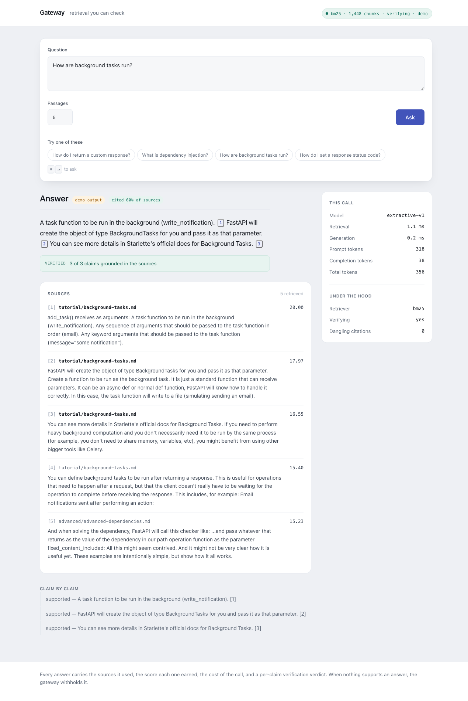

# llm-gateway

A resilient gateway between an application and an LLM provider. It owns the four
things that break in production and get ignored in demos: provider failure, repeated
cost, unsupported answers, and missing traces.

**Status:** Modules 1–3 complete. Resilient client, cache, retrieval with an evaluation
harness, a working UI, and claim verification with abstention. Docker and the final
docs are the remaining items in [PLAN.md](PLAN.md); design rationale in
[ARCHITECTURE.md](ARCHITECTURE.md).

> **Results published.** BM25 reaches **nDCG@10 0.891** and **recall@10 0.922** at
> 3.5 ms p95 over 1,448 chunks, on a corpus pinned by commit. The 51 questions are
> *mechanically verified*, not hand-verified — a verifier proven to reject fabricated
> answers checked each one against the document it cites. What that does and does not
> establish is spelled out in [docs/RESULTS.md](docs/RESULTS.md).

## What it does today

```python
from pathlib import Path

from gateway import LLMClient, Message, OllamaProvider, OpenAIProvider, UsageRecorder

# Ordered by preference. A local model first means the gateway is demonstrable
# with no credentials at all.
with UsageRecorder(path=Path(".usage.jsonl")) as recorder:
    client = LLMClient([OllamaProvider.from_env(), OpenAIProvider.from_env()], recorder)
    answer = client.complete([Message.user("hi")], request_id="r1")
```

- Retries a failing provider with jittered backoff, then fails over to the next one.
- Raises `ProviderExhausted` rather than returning a fabricated answer.
- Opens a circuit breaker after repeated failures so a dead provider stops adding
  latency to every request.
- Retries only what can succeed on a second attempt: 429 and 5xx, never a 401.
- Writes exactly one usage record per provider call. `docs/RESULTS.md` is generated
  from these records, not written by hand.

### Latency is recorded twice, on purpose

| Field | Measures | Use it for |
|---|---|---|
| `latency_ms` | one provider round trip | comparing providers |
| `total_latency_ms` | the whole request, including retries and backoff | the p95 a user actually waits |

Quoting a p95 without saying which one it is makes the number unanswerable in an
interview. `Usage.overhead_ms` exposes the difference directly.

## Providers

| Provider | Credentials | Notes |
|---|---|---|
| `OllamaProvider` | none | Local. The default, so the project runs with no setup |
| `OpenAIProvider` | optional | Speaks the OpenAI wire format, so vLLM, Groq, Together and LM Studio work unchanged |
| `Provider` protocol | — | Your own: implement `complete` and nothing else changes |

`test_providers.py` covers the status-to-retryability table, which is where a wrong
decision costs real latency.

## Run it

```bash
./scripts/fetch_corpus.sh     # pinned FastAPI docs, MIT, 155 files
./scripts/serve.sh            # http://127.0.0.1:8000
```

No credentials and no Docker are required. With neither `OPENAI_API_KEY` nor a local
Ollama server, the service falls back to an extractive provider that answers by
quoting retrieved passages, and labels every such answer **demo output** so it is never
mistaken for a model. Set `OLLAMA_HOST` or `OPENAI_API_KEY` for a real model.

## The interface



Every number the system produces is visible rather than asserted:

| Surface | What it makes legible |
|---|---|
| Answer with inline chips | click a claim, the source highlights |
| Sources panel | ranked chunks with scores, and which were cited |
| Call panel | retrieval vs generation time, model, token counts |
| Claims panel | per-sentence attribution, so a partial answer is visible |
| `cited N%` badge | how much of the retrieved context the model actually used |

An answer that cites a source which was not retrieved shows a red chip and a warning
rather than quietly looking supported. When retrieval finds nothing, the gateway
answers with an explicit refusal: an answer with no evidence behind it is the one thing
this project exists to prevent.

## Retrieval

The boundary between "find relevant text" and "answer the question" is explicit, so a
retriever can be swapped and compared without touching generation.

```python
from gateway.rag import BM25Retriever, chunk_corpus, load_documents

chunks = chunk_corpus(load_documents(Path("corpus")))
retriever = BM25Retriever.build(chunks)

for hit in retriever.retrieve("how do i add a response header", k=5):
    print(f"{hit.score:6.3f}  {hit.doc_id}  {hit.text[:60]}...")
```

`Retriever` is a `Protocol` with four implementations so far: `NullRetriever` (RAG
off), `BM25Retriever`, and later the hybrid and graph retrievers. A retriever that
finds nothing returns an empty list — never low-scoring filler, because the generator
treats the chunk list as ground truth.

## Evaluating a retriever

```bash
./scripts/fetch_corpus.sh              # pinned FastAPI docs, MIT, 155 files
uv run python -m gateway.rag.label       # propose questions from the corpus
uv run python -m gateway.rag.verify_set  # check each answer against its cited document
uv run python -m gateway.rag.promote     # only verified rows reach the gate
uv run python scripts/run_eval.py        # writes docs/results/bm25.{json,md}
uv run python scripts/ablation.py        # the comparison table
```

The ablation set isolates one decision per row and includes a no-retrieval control,
because a comparison without a control cannot show that retrieval is doing anything:

| Variant | What it changes |
|---|---|
| `none` | no retrieval — the control |
| `bm25` | baseline: 1200-char chunks, 200-char overlap |
| `bm25_no_overlap` | chunk overlap disabled |
| `bm25_long` / `bm25_short` | 2400 / 400-char chunks |

`HybridRetriever` fuses several retrievers by reciprocal rank fusion, which uses rank
rather than score because the members' scores are not on a comparable scale.
`explain_fusion` reports each member's contribution, so a fused ranking is auditable
rather than magic.

Metrics are split by whether they are deterministic:

| Metric | Deterministic | Gates CI |
|---|---|---|
| nDCG@10, recall@10, MRR, hit@10 | yes | **yes** |
| Faithfulness, answer quality | no (LLM-judged) | no |

A non-deterministic metric used as a gate produces flaky failures that teams learn to
retry past, which is worse than no gate: it costs time while catching nothing.

### Provenance-derived labels

Each question is written *from* a specific section, so `relevant_doc_ids` is a fact
about how the question was constructed rather than an annotator's guess. That turns a
five-hour annotation task into a review task, and makes the labels checkable. Only the
answer text needs human eyes.

## Verification

Every claim in an answer is checked against the retrieved text before it is released.

| Behaviour | When |
|---|---|
| Answer passes through | every claim grounded in the sources |
| Unsupported claims removed, answer released | some claims grounded |
| **Answer withheld entirely** | nothing grounded |

A fabricated claim cannot earn a citation by naming a real source — the verifier runs
*before* citation binding, so "the status code is cached in Redis [1]" is withheld even
though [1] exists. Citation presence is not evidence.

The default verifier is lexical and needs no model, so verification runs in CI and on a
clean clone. It is the weakest useful check, not a good one: it catches invented facts
and flags paraphrase gaps, and it cannot tell entailment from word overlap.
`NliVerifier` upgrades this to a real entailment model when `transformers` is installed.

Verification is **on whenever a corpus is loaded** and off otherwise. With nothing to
verify against, a gate could only pass or fail arbitrarily, so it reports
`verifying: false` in `/api/health` rather than pretending.

## Evaluating a retriever

```bash
uv sync --group dev          # core only, no heavy ML deps
uv run pytest                # 112 tests, no network required
uv run ruff check .
```

Optional extras: `--extra rag` (embeddings, reranking, NLI), `--extra serve`
(FastAPI), `--extra cache` (Redis).

## What the numbers are worth

BM25 scores nDCG@10 **0.891**, recall@10 **0.922**, MRR **0.846** over 51 questions and
1,448 chunks, with a no-retrieval control scoring 0.000.

Two things keep this honest, and both are in
[docs/RESULTS.md](docs/RESULTS.md) in full:

**The verifier is shown to reject.** It accepted 51 of 51, which is exactly the result
a verifier that does nothing would also produce. So `tests/test_verify_set.py` asserts
that a fabricated answer, an answer citing the wrong document, a broken label, an empty
answer, and a near-duplicate pair are all rejected. Without those controls the headline
number would be decoration.

**The set has known weaknesses.** All 51 questions are single-hop, so the difficulty
breakdown measures nothing. They are generated from the corpus, so they inherit its
vocabulary and flatter lexical retrieval. 51 is a small sample; treat differences under
about 0.02 nDCG as noise. The set is *mechanically* verified — that the answers are
supported by the documents they cite — and not *hand*-verified, because nothing here
checked whether the questions are good.

An earlier run was deleted for exactly this reason. A plausible number from an
unverified set is worse than no number, because it looks like evidence.
